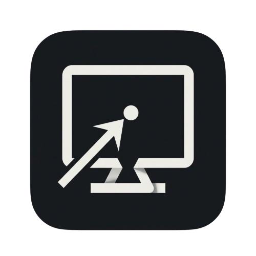

# Computerise

Computer use for any Paseo agent on macOS. Computerise gives Claude, Codex, OpenCode, and other MCP-capable agents tools to see and control the Mac running the Paseo daemon.

Current release: **v0.2.0**. Computerise follows [Semantic Versioning](https://semver.org/); while the API is pre-1.0, minor releases may intentionally tighten configuration contracts.

## What it provides

- Screenshots and zoomed regions
- Text accessibility snapshots for models that cannot consume images
- Mouse clicks, movement, dragging, and scrolling
- Keyboard input and shortcuts
- App opening and foreground restoration
- Per-agent `off`, `ask`, and `auto` modes
- Allow and Deny cards in agent chats
- A one-agent-at-a-time screen lease
- Mandatory built-in blocks for Paseo, terminals, code-running apps, System Settings, and password managers
- Global Stop and Resume controls
- Audit logging that records typed character counts, never typed text

## Requirements

- macOS
- Paseo `>=0.13.0 <0.14.0`
- **Accessibility** permission for Paseo
- **Screen & System Audio Recording** permission for Paseo

After granting Screen Recording, reopen Paseo. New agents receive the computer tools when they are created.

## Use

In an agent composer:

```text
/computer ask
/computer auto
/computer off
/computer status
```

The composer pill and the **Computer** workspace panel provide the same controls. Ask mode requires approval for every input action; read-only screenshots and accessibility snapshots do not ask again after access is enabled.

## Security model

Computer use is off by default. Screenshots and accessibility snapshots are returned to the agent and therefore sent to that agent's model provider. Enabling desktop control weakens a provider's command or filesystem sandbox because the agent can operate signed-in desktop applications with the macOS user's permissions.

Ask mode helps prevent mistakes and prompt-injected actions, but it is not a security boundary against an already-hostile agent with arbitrary local command access. See [OVERVIEW.md](OVERVIEW.md) for the complete safety and data notes.

Screenshots capture the full main display. Computerise refuses capture when a password manager is frontmost, but it does not redact other visible windows behind the front app.

## Development

```bash
npm install
npm test
npm run typecheck
```

The project has separate client, server, and shared runtime boundaries:

```text
index.client.tsx  -> client UI
index.server.ts   -> daemon policy and MCP server
shared/           -> validated contracts and blocklist data
```
